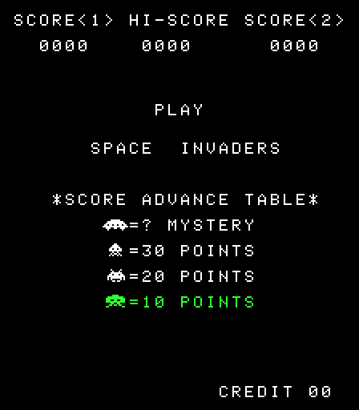
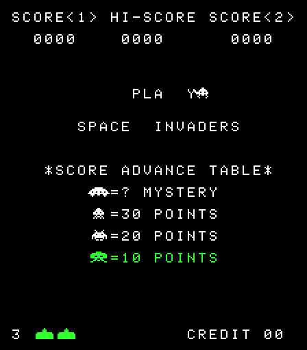
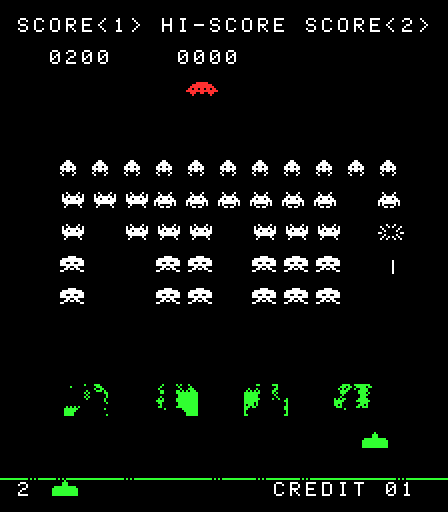
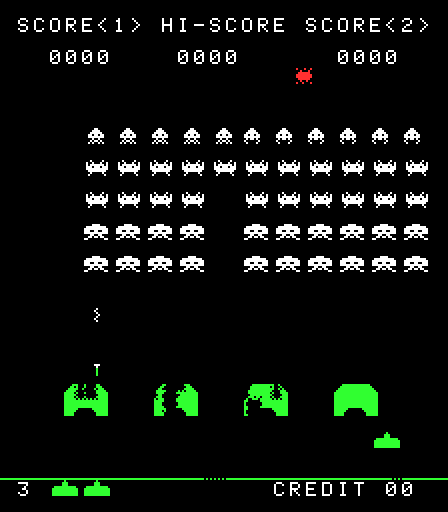
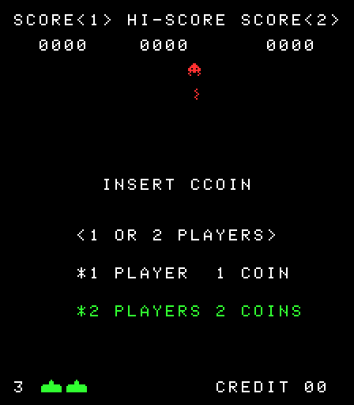

# Invaders — a static recompilation of Space Invaders (8080 → C)

This project translates the 1978 Taito *Space Invaders* arcade ROM (Intel 8080 machine
code) ahead of time into portable C, then compiles that C into a native x64 program for
**Windows** and **Linux** with an **SDL3** frontend. No 8080 emulator runs at play time:
every reachable instruction in the ROM becomes a few lines of C.

It started from [cbeust/space-invade.rs](https://github.com/cbeust/space-invade.rs), an
8080 emulator in Rust, and uses the hardware documentation that project links to.

| | | |
| :---: | :---: | :---: |
|  |  |  |
| Title and score table | The upside-down "Y" gag | Playing: saucer overhead, an invader exploding |
|  |  | |
| Attract-mode demo | The "INSERT CCOIN" gag | |

*Frames captured from the recompiled code with `si_headless --ppm-at` (same colour overlay
as the SDL3 frontend), shown at 2×.*

```
space-invaders.rom ──► recomp/recomp8080.py ──► generated/invaders_recomp.c ──► C compiler ──► invaders(.exe)
                         + config/invaders.hints     + runtime/, machines/invaders/, hosts/main_sdl3.c
                         + config/invaders.sym
```

## Quick start

```sh
./build.sh --run            # Linux x64
./build.sh --windows        # Windows x64 .exe, cross-compiled from Linux with MinGW-w64
```

```bat
build.bat run               :: Windows x64, Visual Studio 2019 or later
```

The scripts fetch whatever is missing:

- `build.sh` installs the toolchain and SDL3 (or SDL3's build dependencies) with
  apt, dnf, pacman or zypper, using `sudo` if needed. `--no-deps` skips this.
- `build.bat` finds Visual Studio with `vswhere` and downloads the official prebuilt
  SDL3 3.4.20 package into `deps/`.
- The ROM and sounds are in the repository, so nothing else is downloaded.

Other options: `--debug`, `--clean`, `--test`, `--regen`, `-j N` (`build.sh`) and
`debug`, `clean`, `test`, `regen` (`build.bat`). Output goes to `build/<platform>-<config>/`.

## Building manually

You need CMake ≥ 3.18 and a C11 compiler. SDL3 is used if CMake can find it; otherwise
it is downloaded and built from GitHub automatically (`INVADERS_FETCH_SDL3=ON`, tag
`release-3.4.20`).

The recompiled code is committed as
[`generated/invaders_recomp.c`](generated/invaders_recomp.c), so building the game needs
Python. When Python 3 is available, CMake regenerates the file in the build tree instead (`INVADERS_REGENERATE=AUTO`; set it to `ON` or `OFF`
to force either way). A test then checks that the committed copy is still current.
After changing the recompiler, hints or symbols, refresh it with:

```sh
python3 recomp/recomp8080.py roms/invaders.zip --entry 0x0000 --entry 0x0008 --entry 0x0010 \
    --code-range 0x0000-0x1fff --hints config/invaders.hints --symbols config/invaders.sym \
    -o generated/invaders_recomp.c
```

### ROM and sounds

[`roms/invaders.zip`](roms) is the MAME *invaders* set and [`sounds/`](sounds) holds the
WAV samples, both from [cbeust/space-invade.rs](https://github.com/cbeust/space-invade.rs).
At configure time CMake joins the zip's chips (h, g, f, e) into the 8 KB program image
and checks its SHA-256. The build then copies the image and `sounds/` next to the
executable, because the recompiled code still reads sprites, text and tables from the ROM
at run time. To use another image, put it at `roms/space-invaders.rom` (git-ignored) or
pass `-DSI_ROM=...`; `-DSI_SOUNDS_DIR=...` picks another sample directory. You can also
pass a ROM path when you run the game.

### Linux x64

```sh
sudo apt install build-essential cmake ninja-build   # plus SDL3, or let CMake fetch it
cmake -B build -G Ninja -DCMAKE_BUILD_TYPE=Release
cmake --build build
./build/invaders
```

Building SDL3 from source needs its usual development packages
(see the [SDL3 Linux README](https://wiki.libsdl.org/SDL3/README-linux#build-dependencies)).

### Windows x64 (Visual Studio 2022)

```bat
cmake -B build -A x64
cmake --build build --config Release
build\Release\invaders.exe
```

If SDL3 is installed through vcpkg, add `-DCMAKE_TOOLCHAIN_FILE=%VCPKG_ROOT%\scripts\buildsystems\vcpkg.cmake`.
MSYS2 / MinGW-w64 (`mingw-w64-x86_64-sdl3`) also works.

### Windows x64 from Linux (MinGW-w64 cross build)

```sh
cmake -B build-win -G Ninja -DCMAKE_TOOLCHAIN_FILE=cmake/mingw-w64-x86_64.cmake \
      -DCMAKE_PREFIX_PATH=/path/to/SDL3-3.4.20/x86_64-w64-mingw32
cmake --build build-win
```

The build copies `space-invaders.rom`, `sounds/` and the SDL3 shared library next to the
executable.

## Playing

| Key | Action |
| --- | --- |
| `C` | insert coin |
| `1` / `2` | one / two player start |
| ← → `Space` | player 1 move / fire |
| `A` `D` `S` | player 2 move / fire |
| `P` | pause (any key resumes) |
| `T` | tilt |
| `F3` | reset |
| `F11` | fullscreen |
| `Esc` | quit |

Options: `invaders [ROM] [--sounds DIR] [--scale N] [--fullscreen] [--ships 3-6]
[--bonus 1000|1500] [--no-coin-info]`. The last three set the cabinet's DIP switches.

## How the recompiler works

`recomp/recomp8080.py` is a single-file Python tool:

1. **Discovery.** Recursive descent from the reset vector (`0000`) and the two interrupt
   vectors (`0008`, `0010`), following jumps, calls and fall-through. Along each path it
   tracks whether HL holds a constant, so `LXI H,x … PCHL` resolves `x` automatically.
2. **Flag liveness.** A backward data-flow analysis over the whole control-flow graph
   works out which of the five flags (S, Z, AC, P, CY) each instruction's result is
   ever read. Dead flag computations are not emitted: 905 of 1,798 for this ROM.
   RET/PCHL are treated as "every flag live", which keeps the analysis sound.
3. **Code generation.** Every instruction becomes a labelled C block. Direct jumps and
   calls become `goto`; RET and PCHL go through a `switch` dispatcher. The 8080 stack
   stays in emulated memory exactly as on hardware, so code that manipulates return
   addresses still works.
4. **Cycle-exact timing.** After every instruction the cycle counter is compared with the
   limit the host passed in. The host can therefore raise the mid-screen and vblank
   interrupts at exactly the same instruction boundaries an interpreter would.

Output is plain C99/C11 that compiles warning-free with GCC, Clang and MSVC
(MSVC-safe fallbacks replace `__builtin_parity` and `__builtin_expect`).

### Indirect jumps and the hints file

Space Invaders has a single computed jump: `RunGameObjs` at `026E` runs each game
object's handler with `PCHL`, after planting `026F` as the return address with `XTHL`.
Those handlers are only named in RAM, so static analysis alone can't find them.
`config/invaders.hints` lists the seven extra entry points: `026F` plus the
`GameObj0`–`GameObj4` handlers (player, player shot, the three alien shot types,
and the saucer). One of them, `050E`, is the attract-mode task where an alien shoots
the extra C in "INSERT CCOIN"; it falls through into the squiggly-shot handler at `050F`.
This is the same kind of function list that tools like N64Recomp use. The hints were
produced by `tools/make_hints.py` from interpreter coverage of a 60,000-frame scripted
play session plus an attract-only session, and they match the labels in the Computer
Archeology listing.

If the recompiled code were ever asked to run an address it never saw, the
`RECOMP_FALLBACK` build option (on by default) interprets that instruction and continues.
With it off, the program stops and names the routine (`PC 1234 (DrawAlien+0x12)`).
In testing the miss count is zero, and the lock-step tests fail if it ever isn't.

### Symbols

`config/invaders.sym` holds 168 routine names, 192 RAM variable names and the I/O port
names from Christopher Cantrell's commented disassembly at
[computerarcheology.com](https://computerarcheology.com/Arcade/SpaceInvaders/Code.html).
They are imported with `tools/import_listing.py` and annotate the generated C:

```c
    /* ======== ScanLine224 ======== */
L_0010: /* 0010: PUSH PSW */
...
L_0016: /* 0016: STA 0x2072 (vblankStatus) */
    WR(0x2072, A);
    CYC(13); CHK(0x0019);
L_001D: /* 001D: CALL 0x17CD (CheckHandleTilt) */
    PUSH16(0x0020); CYC(17); CHK(0x17CD); goto L_17CD;
L_0020: /* 0020: IN 0x01 (INP1) */
```

## Hardware model (`machines/invaders/`)

Based on the Computer Archeology hardware page (which quotes MAME's `mw8080bw` driver):

- 8 KB ROM at `0000`, 1 KB RAM at `2000`, 7 KB video RAM at `2400`. Address lines A14/A15
  are not decoded, so `4000`–`FFFF` mirror the map, and writes to ROM are ignored.
- MB14241 shift register on ports 2 (amount), 4 (data) and 3 (result).
- Inputs on ports 1 and 2 (with DIP switches), sounds on ports 3 and 5, watchdog on port 6.
- 33,333 cycles per frame at 60 Hz. RST 1 (`0008`) fires at scanline 96 and RST 2 (`0010`)
  at scanline 224 (start of vblank), out of 262 lines. Upstream instead fires both at
  exact half-frames.
- The display is rotated 90° counter-clockwise, with a red cellophane band at the top
  and a green one at the bottom.

## Verification

| Check | Result |
| --- | --- |
| `cpudiag` (the diagnostic the Rust project uses), recompiled | passes, with and without flag elimination |
| Reference interpreter vs `8080EXM`, `8080PRE`, `TST8080`, `CPUTEST` | all pass (8080EXM: all 25 CRC groups) |
| Differential fuzz: random programs, recompiled vs interpreter, 2,000 runs | identical registers, flags and memory |
| Recompiled game vs interpreter, 60,000-frame scripted session (attract, 1P and 2P games, tilt) | identical state every frame (full state with `RECOMP_FLAG_OPT=OFF`; excluding flags and the stack page with it on) |
| Recompiled game vs interpreter, attract mode only (no coins), 20,000 frames in CTest and 100,000 by hand | identical state every frame; no interpreter fallback |
| Final frame image | pixel-identical |

`ctest` runs the two lock-step comparisons (scripted play and attract mode, each failing
if the recompiled build ever needs the interpreter fallback) and the committed-C
freshness check, plus the CPU diagnostic if
`-DCPM_TEST_PROGRAM=path/to/cpudiag.bin` is given. The exercisers modify their own code
(they build each test instruction in RAM), so they validate the interpreter. A static
recompiler, by design, can't run self-modifying code.

The 8080 semantics follow the *8080 Assembly Language Programming Manual*: instruction
timings, aux carry from the internal adder on subtraction, and the two-step DAA.
Notably, conditional CALL takes 11 cycles when not taken and 17 when taken.
The Rust emulator has these reversed and approximates the aux carry flag. This project
does not reproduce those quirks.

Speed: about 1,700× real time for the recompiled core, about 2× the interpreter.

## Layout

```
recomp/recomp8080.py      the recompiler
generated/                the recompiled game code (output of recomp8080.py, committed)
roms/invaders.zip         the ROM (MAME set)
sounds/                   WAV samples
config/invaders.hints     extra entry points (PCHL targets)
config/invaders.sym       names from the Computer Archeology listing
runtime/                  CPU state, interrupts, reference interpreter
machines/invaders/        Space Invaders board: memory map, ports, shift register, frame timing
machines/cpm/             minimal CP/M BDOS for running cpudiag and the exercisers
machines/fuzz/            write-protected-code machine for differential fuzzing
hosts/main_sdl3.c         the game (SDL3)
hosts/si_headless.c       scripted headless runner (digests, screenshots, coverage, --attract)
docs/screenshots/         README images
hosts/cpm_run.c           CP/M test runner
hosts/fuzz_run.c          differential fuzz runner
tools/                    make_hints.py, import_listing.py, fuzz_gen.py
tests/compare.cmake       CTest lock-step comparison
cmake/                    MinGW-w64 cross toolchain
build.sh, build.bat       one-step builds with dependency fetching
```

## Resources

- [8080 Assembly Language Programming Manual](https://altairclone.com/downloads/manuals/8080%20Programmers%20Manual.pdf)
- [Space Invaders commented disassembly, hardware and RAM map](https://computerarcheology.com/Arcade/SpaceInvaders/Code.html)
  ([source](https://github.com/topherCantrell/computerarcheology/tree/master/content/Arcade/SpaceInvaders))
- [cpudiag assembly listing](https://github.com/cbeust/space-invade.rs/blob/main/emulator/cpudiag.lst)
- Emulator 101 (`http://www.emulator101.com/`). The https address now redirects
  elsewhere and archived copies weren't reachable from the build environment, so its
  hardware details were taken from the Computer Archeology pages, which cover the same ground.
- 8080 exerciser binaries from [superzazu/8080](https://github.com/superzazu/8080)
